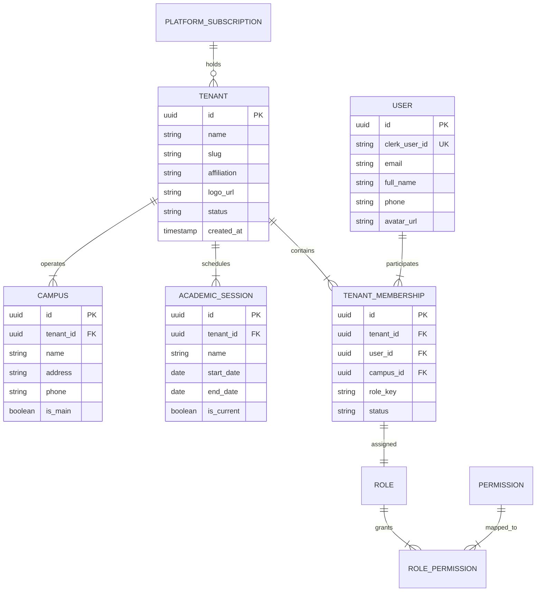

# Entity-Relationship Diagrams (ERD)

## 1. Multi-Tenancy, Organization & Identity Hierarchy



## 2. Academics, Student Information System & Enrollment

```mermaid
erDiagram
    TENANT ||--|{ CLASS : defines
    CLASS ||--|{ SECTION : divides
    CLASS ||--|{ CLASS_SUBJECT : offers
    SUBJECT ||--|{ CLASS_SUBJECT : taught_as
    STUDENT ||--|{ STUDENT_ENROLLMENT : progresses_through
    ACADEMIC_SESSION ||--|{ STUDENT_ENROLLMENT : registers
    SECTION ||--|{ STUDENT_ENROLLMENT : places
    STUDENT ||--|{ STUDENT_GUARDIAN : linked_to
    GUARDIAN ||--|{ STUDENT_GUARDIAN : cares_for
    STUDENT_ENROLLMENT ||--|{ STUDENT_ATTENDANCE : tracks
    STUDENT_ENROLLMENT ||--|{ EXAM_MARK : evaluated_in

    STUDENT {
        uuid id PK
        uuid tenant_id FK
        string admission_number UK
        string full_name
        date dob
        string gender
        string blood_group
        text medical_notes
        string status
    }

    STUDENT_ENROLLMENT {
        uuid id PK
        uuid tenant_id FK
        uuid student_id FK
        uuid academic_session_id FK
        uuid class_id FK
        uuid section_id FK
        integer roll_number
        string status
    }

    STUDENT_ATTENDANCE {
        uuid id PK
        uuid tenant_id FK
        uuid enrollment_id FK
        date attendance_date
        string status
        text remarks
    }
```

## 3. Fee Engine & Financial Ledger

```mermaid
erDiagram
    TENANT ||--|{ FEE_CATEGORY : classifies
    FEE_CATEGORY ||--|{ FEE_STRUCTURE : defines_rate
    CLASS ||--|{ FEE_STRUCTURE : applicable_to
    STUDENT_ENROLLMENT ||--|{ STUDENT_FEE_ALLOCATION : billed_for
    FEE_STRUCTURE ||--|{ STUDENT_FEE_ALLOCATION : based_on
    STUDENT_FEE_ALLOCATION ||--o{ FEE_TRANSACTION_ALLOCATION : cleared_by
    FEE_TRANSACTION ||--|{ FEE_TRANSACTION_ALLOCATION : settles

    FEE_STRUCTURE {
        uuid id PK
        uuid tenant_id FK
        uuid category_id FK
        uuid class_id FK
        decimal amount
        string frequency
        date due_date
    }

    STUDENT_FEE_ALLOCATION {
        uuid id PK
        uuid tenant_id FK
        uuid enrollment_id FK
        uuid structure_id FK
        decimal due_amount
        decimal paid_amount
        decimal discount_amount
        string status
    }

    FEE_TRANSACTION {
        uuid id PK
        uuid tenant_id FK
        string receipt_number UK
        decimal total_amount
        string payment_method
        string razorpay_payment_id
        string status
        timestamp recorded_at
    }
```
